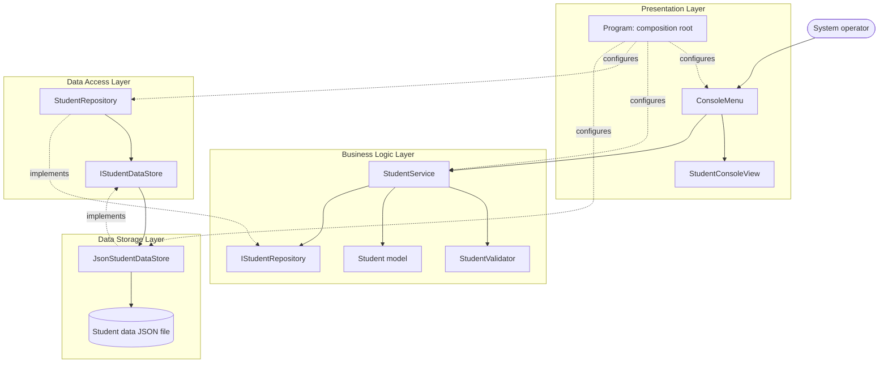

# Student Management System Architecture

## 1. Project Architecture Overview

The Student Management System is a .NET 10 console application for one local operator. The initial version will use four logical layers in the existing application project. Keep each layer in a separate folder and namespace; separate project files are not needed until the application grows.

The dependency direction is:

**Presentation → Business Logic → Data Access → Data Storage**

Requests flow toward storage and results flow back toward the console. A layer should depend only on the next lower-level contract it uses; storage code must not call presentation or business logic.

The proposed initial storage is a JSON file. This is a practical choice for a small, single-user console application, not a requirement imposed by the requirements document. The storage implementation can be replaced later without changing the user workflows or business rules.



## 2. Layer-Wise Responsibilities

### Presentation Layer

- Displays the menu and gathers operator input.
- Converts entered values into the inputs expected by business operations.
- Displays student records, validation feedback, operation results, and concise error messages.
- Handles menu navigation and allows the operator to retry or cancel where appropriate.
- Does not enforce student business rules or access the data file directly.

### Business Logic Layer

- Implements the student-management use cases: add, list, search, update, and delete.
- Validates student information and enforces the business rules in `REQUIREMENTS.md`.
- Checks student ID uniqueness using trimmed, case-insensitive comparison.
- Coordinates repository operations and distinguishes expected outcomes, such as duplicate ID or student not found, from operational failures.
- Does not depend on console APIs, JSON serialization, or file paths.

### Data Access Layer

- Implements the repository contract used by the business layer.
- Performs student collection operations against the storage contract.
- Applies consistent ID matching and stable student-ID ordering when retrieving records.
- Does not format console output or decide how an operator is prompted.

### Data Storage Layer

- Reads and writes the persisted student collection using JSON serialization.
- Owns the data-file path, serialization details, and low-level file operations.
- Reports unreadable, malformed, or unwritable data as failures; it must not silently treat corrupt data as an empty collection.
- Does not contain student workflow rules or console interaction.

## 3. Component Descriptions

The following folder layout is a logical organization within the current project, not a requirement to create a separate assembly for each layer:

```text
StudentManagementConsoleApplication/
|-- Presentation/
|   |-- ConsoleMenu
|   `-- StudentConsoleView
|-- Business/
|   |-- Student
|   |-- StudentService
|   |-- StudentValidator
|   `-- IStudentRepository
|-- DataAccess/
|   |-- StudentRepository
|   `-- IStudentDataStore
|-- DataStorage/
|   `-- JsonStudentDataStore
|-- Program.cs
`-- docs/
```

`Program` remains the entry point and composition root. The `Student` model represents the student data: ID, first name, last name, date of birth, and optional email and phone. `StudentService` coordinates use cases, while `StudentValidator` contains reusable field validation. The repository abstracts student retrieval and persistence from the service. The JSON data store handles only the physical representation and file operations.

## 4. Class Responsibility Matrix

| Layer | Class or contract | Responsibility |
|---|---|---|
| Presentation | `Program` | Creates the dependency-injection container, registers implementations, resolves the application entry point, and starts the menu. |
| Presentation | `ConsoleMenu` | Presents operation choices, dispatches the selected use case, supports retry/cancel behavior, and exits cleanly. |
| Presentation | `StudentConsoleView` | Reads student details and formats student data and user-facing messages. It can use injected text input/output streams to make console behavior testable. |
| Business Logic | `Student` | Represents one student record and its data. It has no console or file-system responsibilities. |
| Business Logic | `StudentService` | Implements add, list, search, update, and delete workflows; coordinates validation and repository calls; enforces duplicate-ID rules. |
| Business Logic | `StudentValidator` | Checks required fields, date-of-birth rules, optional email and phone rules, and returns actionable validation feedback. |
| Business Logic | `IStudentRepository` | Defines the student operations required by the service without specifying how data is stored. |
| Data Access | `StudentRepository` | Implements `IStudentRepository`, works with the data-store contract, and returns student data in the required order. |
| Data Access | `IStudentDataStore` | Defines the minimal load/save operations required by the repository. |
| Data Storage | `JsonStudentDataStore` | Loads and saves the student collection as JSON and reports file or serialization failures. |

## 5. Application Execution Flow

1. `Program` creates and configures the dependency-injection container.
2. The container resolves `ConsoleMenu` and its dependencies.
3. `ConsoleMenu` displays the available operations and reads a selection.
4. The menu gathers operation-specific input through `StudentConsoleView` and calls the appropriate `StudentService` operation.
5. `StudentService` validates input and invokes `IStudentRepository` when data must be read or changed.
6. `StudentRepository` uses `IStudentDataStore`; `JsonStudentDataStore` performs file operations.
7. The result returns through the same chain, and the presentation layer displays the outcome.
8. The menu repeats until the operator selects Exit.

Invalid menu choices and correctable validation failures return to a usable menu state. Storage failures are not represented as successful operations or as “student not found.”

## 6. Student Registration Flow

The registration flow implements FR-001, FR-006, and FR-007. The service validates the full record before asking the repository to save it. A duplicate check uses the trimmed, case-insensitive ID rule from `REQUIREMENTS.md`. Success is displayed only after persistence completes.

```mermaid
sequenceDiagram
	actor Operator
	participant Menu as ConsoleMenu
	participant View as StudentConsoleView
	participant Service as StudentService
	participant Validator as StudentValidator
	participant Repository as StudentRepository
	participant Store as JsonStudentDataStore
	participant File as JSON data file

	Operator->>Menu: Select Add Student
	Menu->>View: Request student details
	View->>Operator: Prompt for required and optional fields
	Operator-->>View: Enter details
	View-->>Menu: Return entered values
	Menu->>Service: Request student registration
	Service->>Validator: Validate student details
	Validator-->>Service: Return validation outcome

	alt Validation fails
		Service-->>Menu: Return field validation feedback
		Menu-->>Operator: Display errors; allow correction or cancellation
	else Validation succeeds
		Service->>Repository: Check whether student ID already exists
		Repository->>Store: Load student records
		Store->>File: Read JSON data
		File-->>Store: Return stored data
		Store-->>Repository: Return records
		Repository-->>Service: Return duplicate-check result

		alt Student ID already exists
			Service-->>Menu: Return duplicate-ID outcome
			Menu-->>Operator: Display duplicate-ID message
		else Student ID is available
			Service->>Repository: Add validated student
			Repository->>Store: Save updated student collection
			Store->>File: Write JSON data
			File-->>Store: Confirm write
			Store-->>Repository: Confirm persistence
			Repository-->>Service: Confirm registration
			Service-->>Menu: Return success
			Menu-->>Operator: Display registration confirmation
		end
	end
```

If reading or writing fails, the storage error follows the error-handling strategy below. The operator must not receive a registration confirmation when persistence has not succeeded.

## 7. Data Storage Strategy

Use one JSON file containing the student collection for the initial single-operator release. The file location should be configurable and default to a per-user application data directory rather than the current working directory or generated `bin`/`obj` directories. This avoids data appearing to disappear when the application is launched from a different directory.

For the expected scale, `StudentRepository` can load the collection, apply a requested change, and ask the data store to save the resulting collection. Reads for display should return students ordered by student ID. ID comparisons must trim surrounding whitespace and ignore casing, consistent with the requirements.

The data store should write to a temporary file and replace the active file only after the new JSON has been written successfully. If the file does not yet exist, it can represent an empty initial collection. If an existing file is unreadable or malformed, the application must report the problem rather than silently overwrite it with an empty collection. Verify the two-second, 10,000-record performance target with a representative data set as required by NFR-007.

This strategy assumes a single operator and no concurrent writers. If simultaneous access, larger data volumes, or richer queries become requirements, replace the JSON store with a database-backed implementation of the same storage/repository contracts.

## 8. Dependency Injection Strategy

Use constructor injection so components declare the collaborators they need. The composition root in `Program` is the only place that selects concrete implementations:

- `IStudentRepository` maps to `StudentRepository`.
- `IStudentDataStore` maps to `JsonStudentDataStore`.
- `StudentService` receives `IStudentRepository`.
- `StudentRepository` receives `IStudentDataStore`.
- Presentation components receive `StudentService` and their input/output abstractions as needed.

The project can use `Microsoft.Extensions.DependencyInjection` as a small, focused dependency for the container. Transient registrations are adequate for this single-run console workflow; a scoped lifetime is unnecessary unless the application later adopts explicit operation scopes. The storage path should be provided through configuration rather than embedded in business logic.

This keeps business logic independent of JSON and lets tests provide an in-memory repository. It also avoids constructing repositories or file stores inside service methods.

## 9. Error Handling Strategy

- Treat invalid fields, duplicate IDs, missing students, and operator cancellation as expected outcomes. Return clear results to the presentation layer rather than using exceptions for normal control flow.
- Keep storage and serialization failures distinct from expected outcomes. The data store should preserve the underlying cause; the repository may add operation context without hiding it.
- Handle operational exceptions at the application/presentation boundary, display a concise message, and continue to the menu when recovery is possible.
- Do not catch and ignore exceptions. Do not report add, update, or delete success until the corresponding save has completed.
- For failed updates or deletes, retain the prior persisted record. Use the temporary-write-and-replace strategy to reduce the chance of partial file writes.
- Treat malformed or unreadable existing data as an error requiring attention, not as an empty data set.
- Avoid displaying stack traces or internal paths during normal use. Detailed diagnostics can be added later if logging becomes part of the project.

## 10. Unit Testing Strategy

Place automated tests in a separate test project. Test the business layer without a console or real data file by supplying a simple in-memory fake implementation of `IStudentRepository`.

| Test target | Example coverage |
|---|---|
| `StudentValidator` | Required and whitespace-only values, valid and future dates, malformed dates, optional valid/invalid email, and optional phone with or without digits. |
| `StudentService` | Successful add, duplicate IDs with different casing or surrounding spaces, list ordering, found/not-found searches, update without changing ID, delete confirmation behavior, validation failures, and repository failures without false success. |
| Presentation components | Supply test input and capture output to verify menu navigation, prompts, readable results, retry behavior, and error messages without an interactive terminal. |
| `StudentRepository` and `JsonStudentDataStore` | Use temporary files for persistence across reloads, missing-file initialization, case-insensitive ID behavior, malformed JSON, read/write failures, and preservation of existing data after a failed save. These are storage integration tests rather than isolated business unit tests. |

Keep unit tests fast and deterministic. Use temporary locations for file tests and clean them up after each test. Cover both positive and negative scenarios, including the acceptance criteria in `REQUIREMENTS.md`.
